# Lab 8 – Data Visualization using Python Libraries

**Name:** Girish Raja Thiyagrajan  
**Course:** CYSE 6200


This lab explores the **Wine Quality (Red)** dataset from the UC Irvine Machine Learning Repository using **Pandas**, **Matplotlib** and **Seaborn** in a Google Colab notebook. The goal is to load and filter real-world data, then use different visualization techniques to find patterns that are hard to see in a raw table.

## 📂 Repository Contents

| File / Folder | Description |
|---|---|
| `Lab8_Data_Visualization.ipynb` | Google Colab notebook with all code, charts and observations |
| `chart01.png` – `chart12.png` | Output charts captured from the notebook |
| `README.md` | Project overview (this file) |

## 📊 Dataset

- **Name:** Wine Quality – Red Wine
- **Source:** [UCI Machine Learning Repository](https://archive.ics.uci.edu/dataset/186/wine+quality)
- **Size:** 1,599 wine samples, 12 columns
- **Features:** fixed acidity, volatile acidity, citric acid, residual sugar, chlorides, free sulfur dioxide, total sulfur dioxide, density, pH, sulphates, alcohol
- **Target:** `quality` – a score from 0 to 10 given by wine experts (values in this dataset range from 3 to 8)

The data is loaded directly from the UCI URL into a Pandas DataFrame:

```python
url = "https://archive.ics.uci.edu/ml/machine-learning-databases/wine-quality/winequality-red.csv"
df = pd.read_csv(url, sep=";")
```

## 🧠 Topics Covered

- Introduction to Python and its uses
- Advantages of virtual environment workspaces
- Python (Jupyter) notebooks and Google Colab
- Data visualization, its uses and different techniques
- Loading datasets and reading data into Pandas DataFrames
- Filtering data and plotting it with Matplotlib and Seaborn

## 🔍 Data Filtering

Three filtered views of the data were created for the visualizations:

- **Quality category** – a new column grouping wines into *Low* (≤ 5), *Medium* (6) and *High* (≥ 7)
- **High-quality wines** – only wines with quality ≥ 7
- **High-alcohol wines** – only wines with alcohol above the median

## 📈 Visualizations

### Matplotlib

**1. Histogram – Distribution of Alcohol Content**

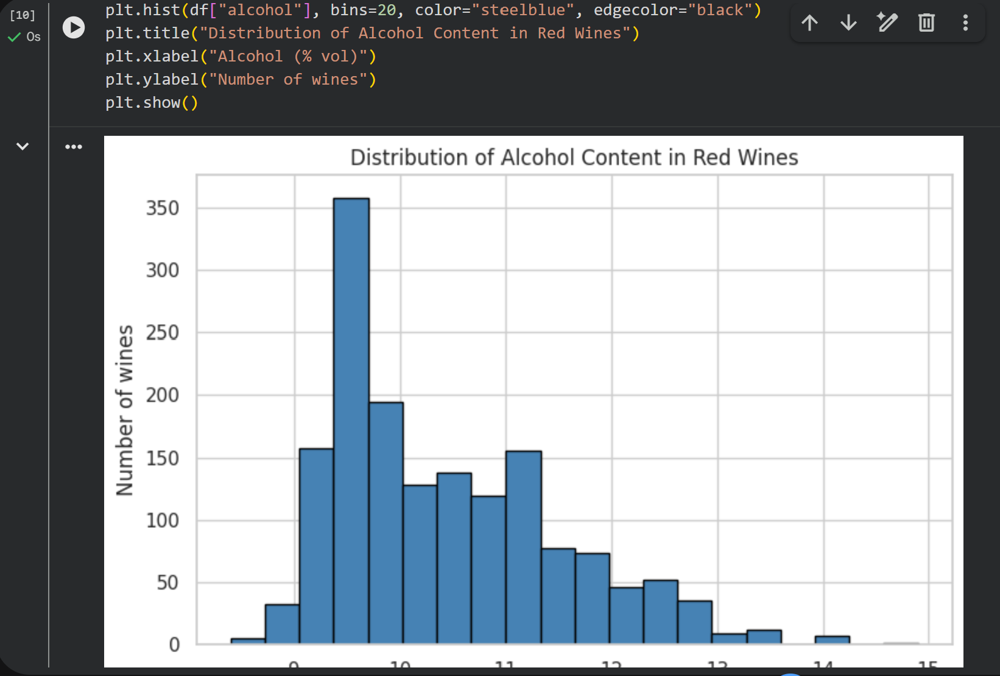

Most wines contain between 9% and 11% alcohol, with the tallest bar around 9.5%. The distribution is right-skewed, with only a few wines above 13%.

**2. Bar Chart – Number of Wines per Quality Score**

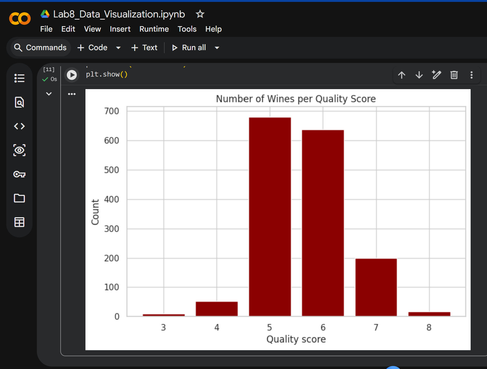

The majority of wines are rated 5 or 6. Very few wines are rated 3, 4 or 8, so the dataset is imbalanced.

**3. Scatter Plot – Alcohol vs. Volatile Acidity**

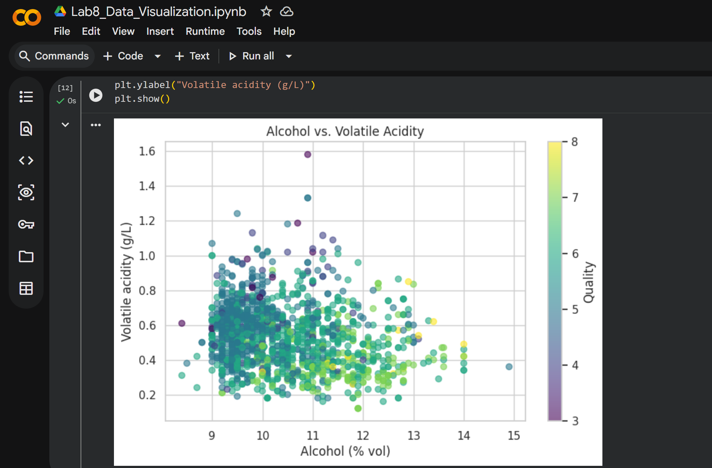

Higher-quality wines (yellow/green points) tend to appear at higher alcohol levels and lower volatile acidity, while lower-quality wines (purple/blue) cluster at lower alcohol.

**4. Pie Chart – Share of Each Quality Category**

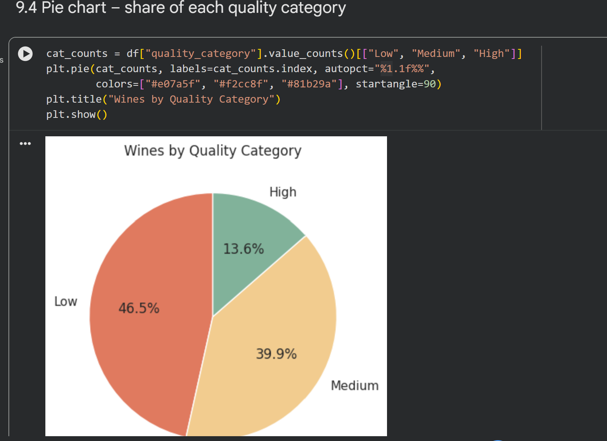

46.5% of wines are Low quality, 39.9% are Medium and only 13.6% are High quality.

**5. Line Plot – Average Alcohol by Quality Score**

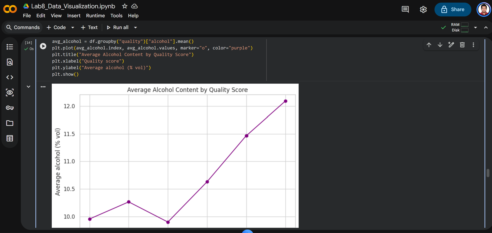

Average alcohol stays around 10% for scores 3–5, then rises steadily to about 12% for wines rated 8.

### Seaborn

**6. Count Plot – Wines by Quality Category**

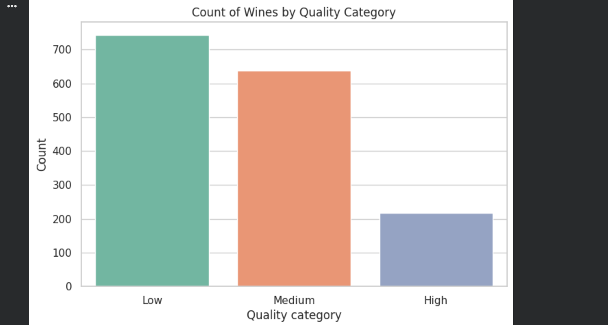

Low-quality wines are the largest group (over 700), followed by Medium (about 640) and High (about 220).

**7. Box Plot – Alcohol Content by Quality Score**

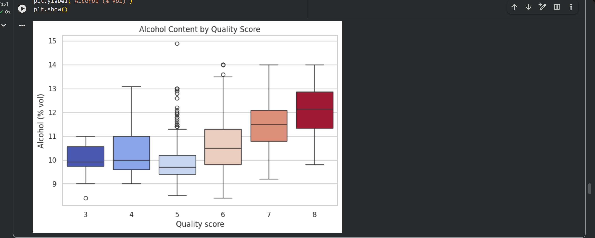

The median alcohol level is clearly higher for wines rated 7 and 8. Score 5 has many high-alcohol outliers.

**8. Violin Plot – Volatile Acidity by Quality Category**

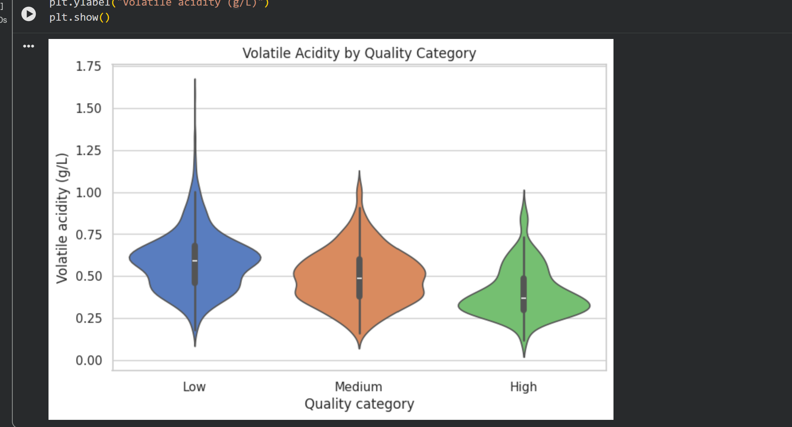

Volatile acidity decreases from Low to High quality. Low-quality wines also have a much wider spread, reaching above 1.5 g/L.

**9. Regression Plot – Alcohol vs. Quality with Trend Line**

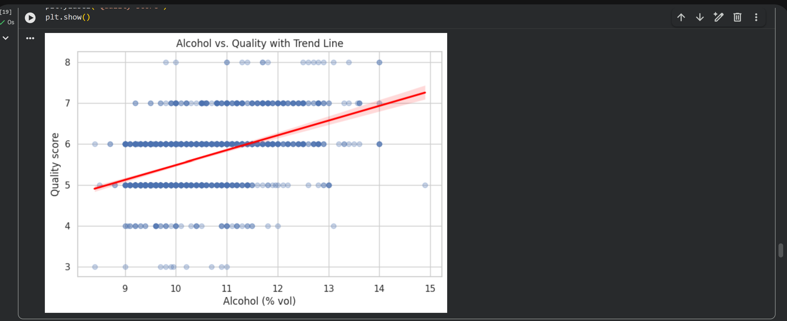

The upward trend line confirms a positive relationship between alcohol content and quality score.

**10. Histogram with KDE – Sulphates: All Wines vs. High-Quality Wines**

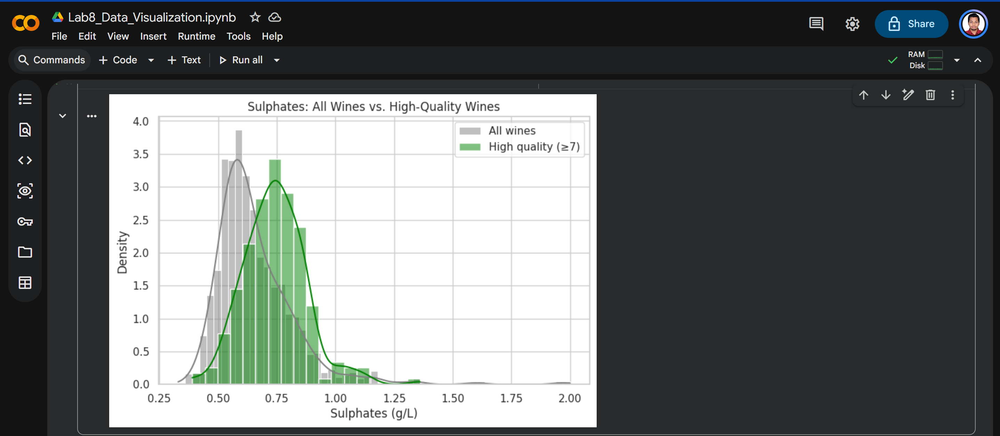

High-quality wines peak at around 0.75 g/L of sulphates, compared to about 0.6 g/L for all wines, so better wines tend to have slightly more sulphates.

**11. Pair Plot – Key Features by Quality Category**

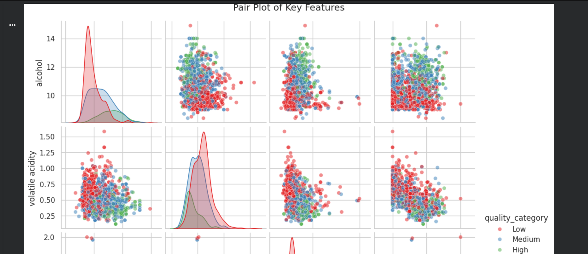

The pair plot compares alcohol, volatile acidity, sulphates and citric acid at once. High-quality wines (green) separate most clearly on alcohol and volatile acidity.

**12. Scatter Plot (Filtered) – High-Alcohol Wines: Citric Acid vs. Volatile Acidity**

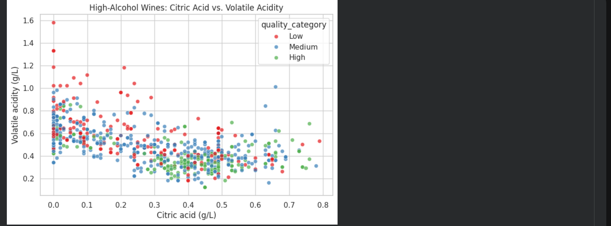

Among high-alcohol wines, volatile acidity drops as citric acid increases. High-quality wines cluster at low volatile acidity and moderate-to-high citric acid.

## ✅ Key Findings

- Most red wines in the dataset are of average quality (scores 5–6); high-quality wines make up only 13.6%.
- **Alcohol** has the strongest positive relationship with quality.
- **Volatile acidity** has the strongest negative relationship with quality.
- High-quality wines tend to have slightly higher **sulphates** and **citric acid**.
- Visualizing the data made these patterns much easier to see than reading the raw numbers.

## ▶️ How to Run

1. Open the notebook in Google Colab: **File → Open notebook → GitHub** and paste this repository's URL, or click the **Open in Colab** badge at the top of the notebook.
2. Click **Runtime → Run all**.
3. No installation is needed. Pandas, Matplotlib and Seaborn are pre-installed in Colab, and the dataset loads directly from the UCI repository.

To run locally instead:

```bash
python -m venv venv
source venv/bin/activate        # Windows: venv\Scripts\activate
pip install pandas matplotlib seaborn jupyter
jupyter notebook Lab8_Data_Visualization.ipynb
```

## 📚 References

- Cortez, P., Cerdeira, A., Almeida, F., Matos, T., & Reis, J. (2009). *Wine Quality* [Dataset]. UCI Machine Learning Repository. https://doi.org/10.24432/C56S3T
- [Pandas documentation](https://pandas.pydata.org/docs/)
- [Matplotlib documentation](https://matplotlib.org/stable/)
- [Seaborn documentation](https://seaborn.pydata.org/)

---
**Author:** Girish Raja Thiyagrajan · **Course:** CYSE 6200 · **Lab 8**
